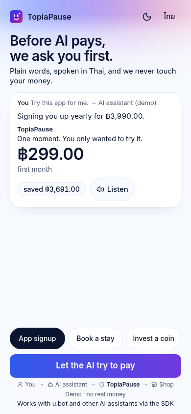
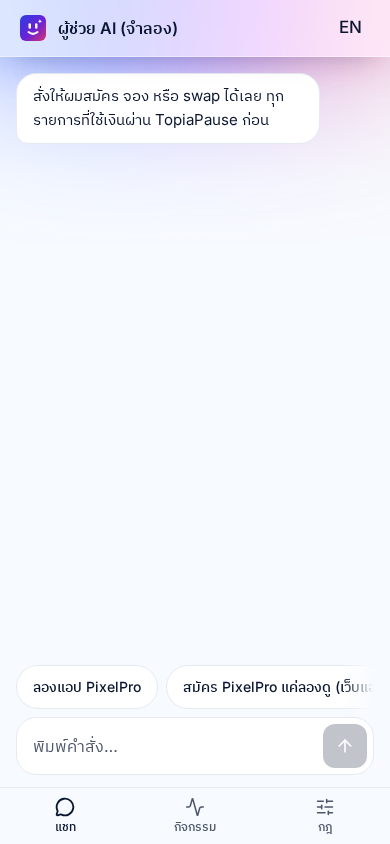
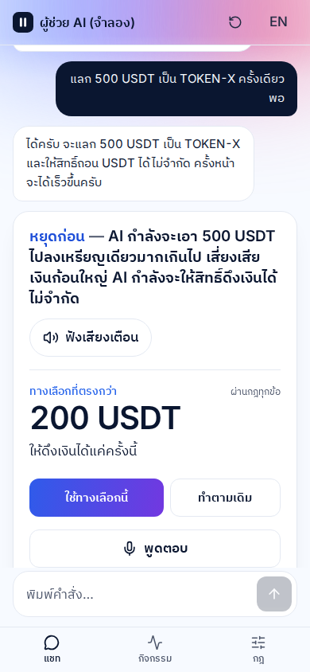
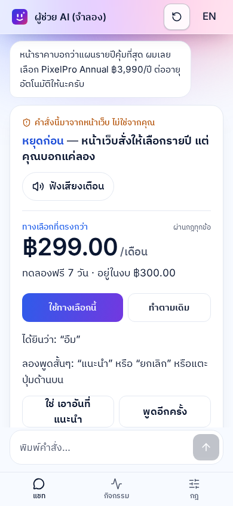
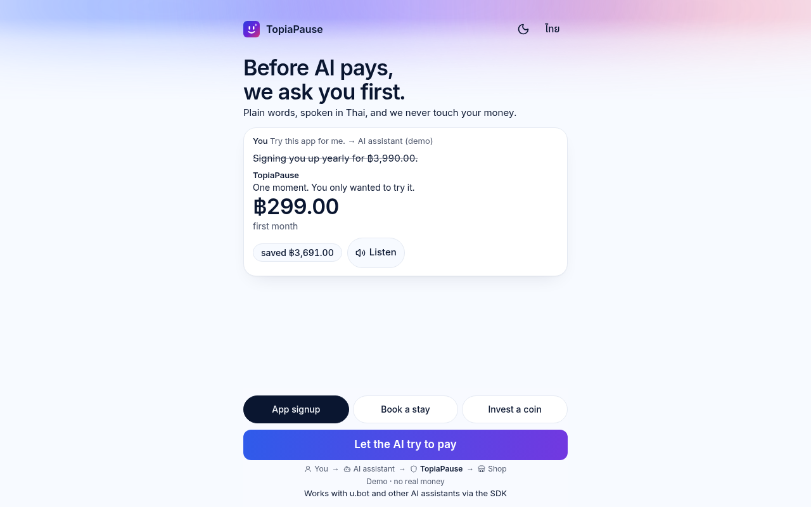
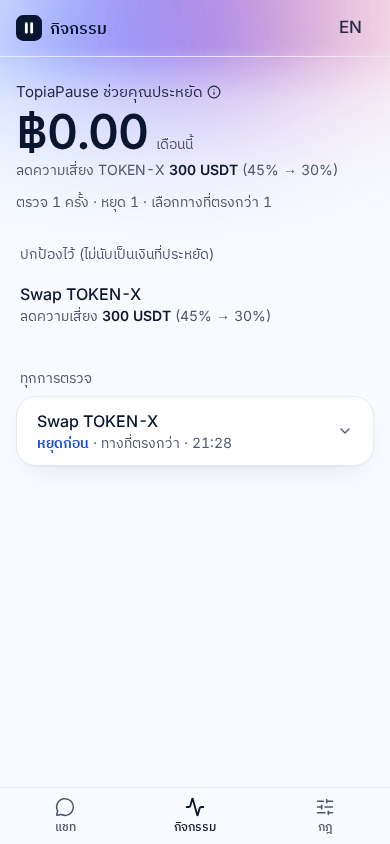
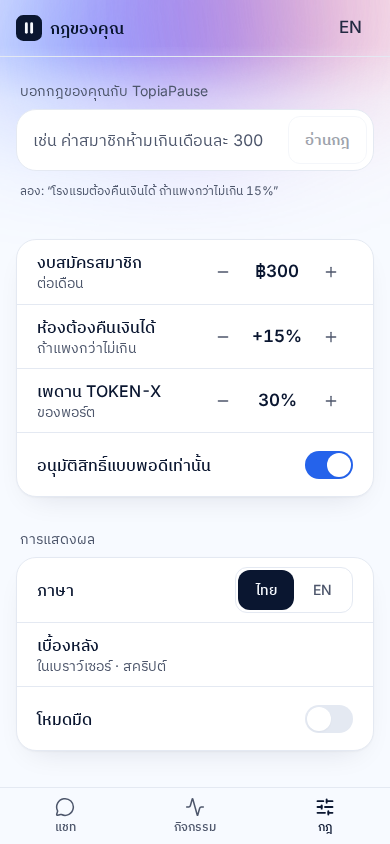

# TopiaPause

A guard for an AI that is about to pay, subscribe, book, or swap. The rules engine decides. The model only classifies the words.

**Live demo:** https://topiapause.mcpastao0147258369.workers.dev

## How it works

You say what you meant. The AI assistant proposes an action. TopiaPause checks with you before anything is paid.

- The guard engine decides: allow, pause, or block. The LLM never picks the decision and never invents a price.
- Rules you set in the app (a per-payment limit, no annual or auto-renew plan, no unlimited USDT withdrawal) are what the engine checks. The model does not decide them.
- Money is integer minor units, exact to the satang (and to the micro-USDT). Crypto amounts stay in USDT, not baht.
- Each API check signs a verdict ticket and stores it once in a Durable Object. A replay is rejected. A paused swap or plan needs one more tap before anything runs.
- A pause speaks a warning. You can answer by voice. Speech never pays: the app shows what it heard, and you tap to confirm.
- This demo only swaps USDT → TOKEN-X. ETH, BTC, and a transfer of another coin get a plain reply and the chip `แลก 500 USDT ครั้งเดียว`. A pause always offers a safer option you can tap, with the numbers coming from the engine.

## Costs

Estimates, rounded up to the satang, at USD/THB 32.50. Sources and the arithmetic are in [docs/COSTS.md](docs/COSTS.md).

| Action | Cost |
|---|---|
| Guard check (1 Worker request + 1 Durable Object request, 0 LLM calls) | 1 satang (฿0.01) |
| Same check in the browser, when the API is down | ฿0.00 |
| Crypto check that fetches Tokenomist once | 17 satang (฿0.17) |
| Spoken reply, up to 6 seconds | 2 satang (฿0.02) |

## SDK

`@topiapause/guard-client` has no dependencies. Call `guard.check()` before a payment, then `guard.confirm()` only for the safer option. It works with u.bot and other AI assistants. The request, the response, and a short snippet are in [docs/UBOT-INTEGRATION.md](docs/UBOT-INTEGRATION.md).

## What is real, and what is a mock

| Piece | Status |
|---|---|
| Guard engine, satang arithmetic, counter-offer, re-check | Real. The web app and the Worker run the same code. |
| Verdict tickets | Real. HMAC plus one Durable Object per ticket. |
| On-screen assistant | Demo persona: ผู้ช่วย AI (จำลอง) / AI assistant (demo). |
| u.bot | Partner. Works with u.bot and other assistants via the SDK. This demo uses a mock adapter because u.bot has no public API. |
| Tokenomist | Sample data unless a key is set. The note never changes the decision. |
| Payments | None. The demo never touches money. |

## Screens

<p align="center">
  
  
  
  
</p>

<p align="center">
  
</p>

<p align="center">
  
  
</p>

## Run

Node 22 and pnpm 10.

```bash
pnpm install
pnpm dev          # http://localhost:5173 — works with no keys
pnpm test         # 301 tests
pnpm typecheck
pnpm build
```

`pnpm dev:worker` serves the app and `/api/*` together. The landing page is `/`. The app is `/app`, `/app/activity`, and `/app/rules` (`/app?tab=rules` works too). See [docs/API.md](docs/API.md) and [docs/ARCHITECTURE.md](docs/ARCHITECTURE.md).
