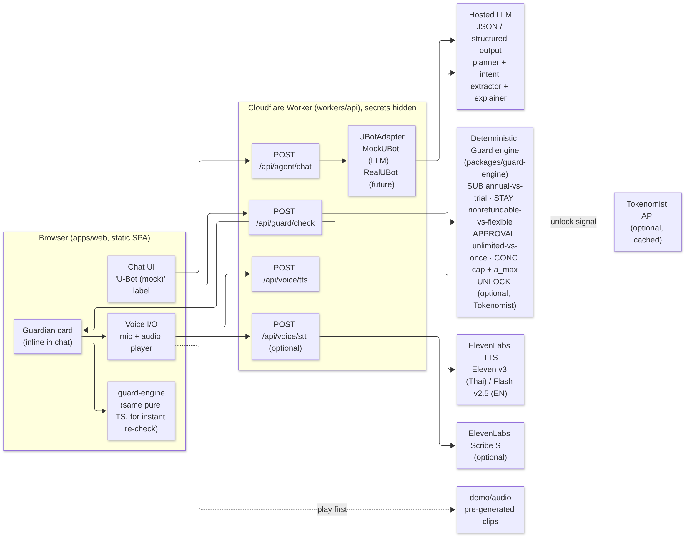
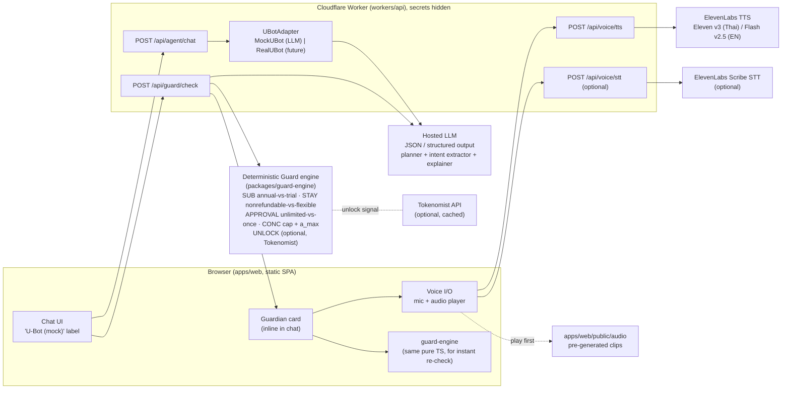
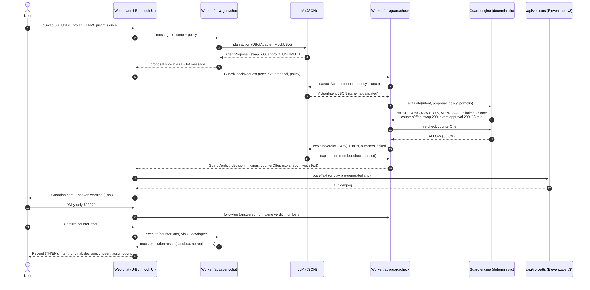
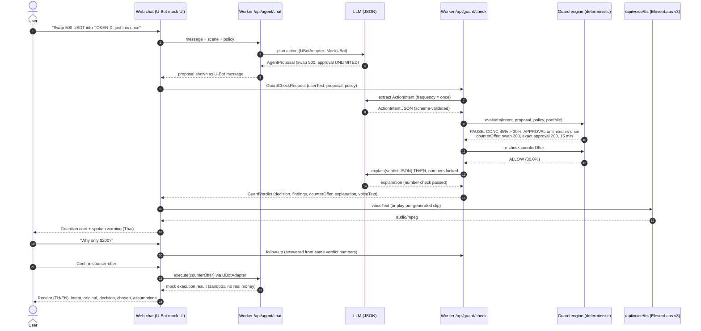

# TopiaPause — Architecture

> **Think before your AI spends.**
> *AI agents do what you say. TopiaPause makes sure they do what you meant.*

Status: build-ready spec for U-Hackathon 2026 (Track AI), started on-site Thu 15 Oct 2026. Source research: [pre-research-v2.md](pre-research-v2.md). Thai summary: [architecture-th.md](architecture-th.md).
Labels: **[ASSUMPTION]** = our design choice / not externally confirmed.

---

## 1. Goal & Principle

TopiaPause is a **second-layer guard** for AI agents that spend money for a user. It catches **intent mismatch**: the gap between what the user *said* and what the agent is *about to do*.

| User said | Agent about to do | Guard rule |
|---|---|---|
| "try this app" | annual auto-renew plan | `SUB_COMMITMENT` |
| "cheap hotel, plans may change" | non-refundable room | `STAY_FLEXIBILITY` |
| "just once" | unlimited token approval | `APPROVAL_SCOPE` |
| "swap 500 USDT to TOKEN-X" | portfolio exceeds user's cap (45% vs 30%) | `CONC_CAP` (+ `a_max`) |

**Principle: AI proposes, rules decide, you sign.**

1. The LLM only does language work: understanding the request, planning as the mock U-Bot, and explaining in Thai and English.
2. **Every number** (prices, gaps, %, `a_max`) comes from the deterministic `guard-engine`. If the LLM's explanation contains any number not in the engine's output, it is rejected and a template is used instead.
3. Nothing executes without explicit user confirmation, and execution is **mock/sandbox** (no real money).
4. U-Bot is shown as **"U-Bot (mock)"** until a real U-Bot API is confirmed (see §7).

---

## 2. System Diagram





Notes:
- `guard-engine` is a pure TS package. The Worker imports it for the authoritative check, and the web app imports the same package for instant previews (for example, a fee slider). Both must give identical results.
- Voice: play the **pre-generated clip** for known demo lines first, and only call live TTS for dynamic text. If TTS fails, fall back to browser `speechSynthesis`, then to text only.
- Thai TTS requires **Eleven v3**, because Flash v2.5 has no Thai. Verify the v3 model id and latency on our account at the start.

---

## 3. Sequence (Scene 3: "just once")





---

## 4. Repo Layout (monorepo, pnpm workspaces) [ASSUMPTION]

```
topiapause/
├─ apps/
│  └─ web/                 # React + TS + Vite + Tailwind; chat UI, Guardian card, voice, receipt
│     ├─ src/components/   # ChatThread, MessageBubble, GuardianCard, CounterOfferButton, ReceiptCard, VoiceButton
│     ├─ src/scenes/       # scene presets (subscription, stay, crypto) + mock catalogs
│     └─ public/           # _headers, _redirects (if Pages), icons
├─ workers/
│  └─ api/                 # Cloudflare Worker: routes, LLM client, UBotAdapter, ElevenLabs/Tokenomist proxies
├─ packages/
│  ├─ guard-engine/        # pure TS, no I/O: rules, a_max, precedence, counter-offer, re-check (+ Vitest)
│  └─ shared/              # TS types (contracts below), JSON schemas, i18n templates (TH/EN)
├─ demo/
│  └─ audio/               # pre-generated ElevenLabs clips: <scene>-<lang>-<key>.mp3 + manifest.json
├─ docs/                   # ARCHITECTURE.md, pre-research-v2.md, pitch, write-up
└─ README.md
```

---

## 5. Data Contracts (`packages/shared`)

```ts
// ---- Money & common ----
export type Lang = 'th' | 'en';
export type Decision = 'allow' | 'pause' | 'block';
export interface Money { amount: number; currency: 'THB' | 'USD' | 'USDT'; } // integer minor units in engine

// ---- User policy (memory) ----
export interface UserPolicy {
  monthlySubscriptionCap?: Money;          // e.g. 300 THB / month
  requireRefundableWhenFlexible: boolean;   // default true
  maxRefundablePremiumPct: number;          // e.g. 15 (% of non-refundable total)
  tokenConcentrationCaps: Record<string, number>; // e.g. { 'TOKEN-X': 0.30 }
  approvalMode: 'exact' | 'allow_unlimited';     // default 'exact'
  oneTimeApprovalMaxExpirySec: number;      // e.g. 900
  unlockWarnPctOfCirculating?: number;      // optional Tokenomist rule, e.g. 1.0
}

// ---- What the user meant (LLM-extracted, schema-validated) ----
export interface ActionIntent {
  goal: 'try_app' | 'book_stay' | 'swap_token' | 'other';
  commitment: 'trial' | 'once' | 'ongoing' | 'unspecified';
  priceSensitivity: 'cheap' | 'normal';
  flexibilityNeeded: boolean | 'unknown';
  budget?: Money;
  amount?: Money;                           // e.g. 500 USDT
  fromAsset?: string; toAsset?: string;
  language: Lang;
  confidence: number;                       // 0..1; < 0.7 -> pause (LOW_CONFIDENCE)
  rawText: string;
}

// ---- What the agent is about to do ----
export type AgentProposal =
  | SubscriptionProposal | StayProposal | TokenSwapProposal;

interface ProposalBase {
  proposalId: string;
  agent: { name: 'U-Bot (mock)' | 'U-Bot'; adapter: 'mock' | 'real' };
  summary: string;                          // agent's own wording (display only)
}
export interface SubscriptionProposal extends ProposalBase {
  kind: 'subscription';
  merchant: string; planId: string;
  price: Money; interval: 'month' | 'year'; autoRenew: boolean; trialDays: number;
  catalogAlternatives: Array<{ planId: string; price: Money; interval: 'month'|'year'; trialDays: number }>;
}
export interface StayProposal extends ProposalBase {
  kind: 'stay';
  hotel: string; nightlyPrice: Money; totalPrice: Money; // total incl. mandatory fees
  refundable: boolean; freeCancelUntil?: string;          // ISO
  catalogAlternatives: Array<{ hotel: string; totalPrice: Money; refundable: boolean; freeCancelUntil?: string }>;
}
export interface TokenSwapProposal extends ProposalBase {
  kind: 'token_swap';
  fromAsset: string; toAsset: string; amountIn: Money;
  feeRate: number;                          // f, e.g. 0.003
  gasUsd: number;                           // g
  approval: { spender: string; type: 'exact' | 'unlimited'; amount?: Money; expirySec?: number };
  portfolio: { totalUsd: number; holdingsUsd: Record<string, number>; balances: Record<string, number> };
}

// ---- Guard output ----
export interface Finding {
  ruleId: 'SUB_COMMITMENT' | 'SUB_OVER_CAP' | 'STAY_FLEXIBILITY' | 'STAY_HIDDEN_TOTAL'
        | 'APPROVAL_SCOPE' | 'APPROVAL_EXPIRY' | 'CONC_CAP' | 'INSUFFICIENT_BALANCE'
        | 'INVALID_INPUT' | 'LOW_CONFIDENCE' | 'UNLOCK_SOON';
  severity: Decision;                       // block > pause > allow
  evidence: Record<string, number | string | boolean>; // engine-computed numbers only
  messageKey: string;                       // i18n template key
}
export interface CounterOffer {
  proposal: AgentProposal;                  // modified, intent-matching proposal
  recheck: Decision;                        // must be 'allow' to be offered
  diff: Record<string, { from: number | string; to: number | string }>;
}
export interface GuardVerdict {
  decision: Decision;
  findings: Finding[];
  counterOffer?: CounterOffer;
  metrics: Record<string, number>;          // e.g. postTradeSharePct, aMaxUsd, monthlyEquivalent
  assumptions: string[];                    // shown every time
  explanation: { th: string; en: string; source: 'llm' | 'template' };
  voiceText: { th: string; en: string; clipId?: string }; // clipId -> apps/web/public/audio
  engineVersion: string;
}

// ---- Receipt ----
export interface Receipt {
  receiptId: string; createdAt: string; language: Lang;
  userText: string; intent: ActionIntent;
  originalProposal: AgentProposal; verdict: GuardVerdict;
  userChoice: 'counter_offer' | 'original' | 'cancel';
  execution: { mode: 'mock' | 'testnet'; status: 'success' | 'failed' | 'skipped'; ref?: string };
}
```

### 5.1 Engine rules & precedence (`block > pause > allow`)

| Rule | Trigger | Severity | Counter-offer |
|---|---|---|---|
| SUB_COMMITMENT | intent.commitment ∈ {trial, unspecified} AND interval = year | pause | free trial / monthly plan from catalog |
| SUB_OVER_CAP | monthly equivalent > monthlySubscriptionCap | pause | cheapest plan ≤ cap |
| STAY_FLEXIBILITY | flexibilityNeeded ≠ false AND !refundable | pause | cheapest refundable if premium ≤ maxRefundablePremiumPct |
| STAY_HIDDEN_TOTAL | totalPrice > displayed price (fees) | pause | compare on totals |
| APPROVAL_SCOPE | commitment = once AND approval.type = unlimited | pause | exact approval = amountIn |
| APPROVAL_EXPIRY | once AND expiry > oneTimeApprovalMaxExpirySec | pause | expiry = max allowed |
| CONC_CAP | post-trade share > cap | pause (block if a_max = 0) | swap a_max |
| INSUFFICIENT_BALANCE / INVALID_INPUT | amount > balance, NaN, ≤ 0 | block | — |
| LOW_CONFIDENCE | intent.confidence < 0.7 | pause | ask user to confirm fields |
| UNLOCK_SOON (optional) | Tokenomist unlock ≥ X% within 7 days | pause (info) | — |

Every counter-offer goes through `evaluate()` again. It is offered only if the re-check returns `allow`.

### 5.2 Concentration formula

```
a_max = min( B , max(0, (c·(V − g) − H) / (c + (1 − c)·(1 − f))) )   // round DOWN to asset decimals
```

- `V` = portfolio USD, `H` = current target holding, `B` = source balance, `c` = cap, `f` = fee rate, `g` = gas USD (paid from a non-target asset).
- Worst case for the cap is zero slippage, so `k = 1 − f`.
- Compute in integer minor units, e.g. USDT has 6 decimals.

---

## 6. API Endpoints (`workers/api`)

| Method & path | Request | Response | Notes |
|---|---|---|---|
| `POST /api/agent/chat` | `{ sessionId, message, scene?, policy, lang }` | `{ reply, proposal?: AgentProposal }` | Goes through `UBotAdapter` (mock = LLM + scene catalog, JSON schema enforced) |
| `POST /api/agent/execute` | `{ proposal }` | `{ execution }` | Mock only; requires a prior verdict id + user confirm flag |
| `POST /api/guard/check` | `{ userText, proposal, policy, lang, followUp? }` | `GuardVerdict` | LLM intent extraction → engine → re-check → LLM explain (number-locked) |
| `POST /api/voice/tts` | `{ text, lang, clipId? }` | `audio/mpeg` | ElevenLabs proxy. TH → Eleven v3, EN → Flash v2.5. Cache by hash. Max 400 chars. Rate-limited. |
| `POST /api/voice/stt` | audio blob, `lang` | `{ text }` | Optional, ElevenLabs Scribe (`language_code: tha`) |
| `GET /api/market/unlocks?symbol=` | — | `{ nextUnlock?, pctOfCirculating? }` | Optional Tokenomist proxy, cached 1 h |

All endpoints:
- validate input with JSON schema
- time out at 12 s and return a typed error
- send CORS headers restricted to our origin
- never return provider error bodies containing keys

---

## 7. U-Bot Adapter (honest mock)

```ts
export interface UBotAdapter {
  readonly label: 'U-Bot (mock)' | 'U-Bot';
  chat(input: { sessionId: string; message: string; scene?: string; lang: Lang }):
    Promise<{ reply: string; proposal?: AgentProposal }>;
  execute(input: { proposal: AgentProposal; verdictId: string; userConfirmed: true }):
    Promise<Receipt['execution']>;
}
// MockUBotAdapter: LLM + scene catalogs, execute() returns mode:'mock'.
// RealUBotAdapter: implemented ONLY if mentors confirm a U-Bot API; must keep guard check before execute.
```

Rules:
- The UI always shows the adapter label.
- The pitch says "mock" until a real API exists.
- The guard is called **before** `execute()`.
- The guard never holds credentials.

---

## 8. Environment Variables / Secrets

| Name | Where | Required | Purpose |
|---|---|---|---|
| `LLM_API_KEY` | Worker secret | optional | OpenAI-compatible LLM (JSON output); scripted U-Bot without it |
| `LLM_MODEL` | Worker var | with key | Model id |
| `LLM_BASE_URL` | Worker var | optional | Defaults to `https://api.openai.com/v1` |
| `ELEVENLABS_API_KEY` | Worker secret | optional | TTS; browser speech without it |
| `ELEVENLABS_VOICE_ID` | Worker var | with key | Voice id |
| `ELEVENLABS_MODEL_ID` | Worker var | optional | Defaults to `eleven_v3` (verify) |
| `ALLOWED_ORIGIN` | Worker var | optional | Extra origin for chat/TTS/execute; `guard/check` is open to all |

The web app is served by the same Worker, so it needs no API URL and no build-time env. See [API.md](API.md) for the endpoints.

Set secrets with `wrangler secret put <NAME>`. Never commit `.dev.vars`.

---

## 9. Deploy

- **Option A (recommended):** a single Cloudflare Worker with **static assets** serving `apps/web/dist`, plus `/api/*` routes. Set `not_found_handling: "single-page-application"`. One URL, no CORS. [ASSUMPTION]
- **Option B:** Cloudflare Pages (web) + a separate Worker (api), with `ALLOWED_ORIGIN` set.
- Backup: the same static build on Vercel/Netlify pointing at the Worker.
- Before demo:
  - open the site in a fresh session and on mobile
  - make sure the `/audio/*.mp3` clips are reachable (`pnpm voice:pregen`)
  - make sure preset buttons work even if the LLM is down

---

## 10. Testing Plan

`packages/guard-engine` uses Vitest and must pass before every deploy.

| # | Case | Expected |
|---|---|---|
| T1 | Crypto base: V=2000, H=400, B=500, c=0.30, f=0, g=0; swap 500 | `pause` (CONC_CAP 45%), a_max = **200.000000** |
| T2 | Same, f=0.003 | a_max = **200.420883** USDT (exact 200.4208838…, floored to the micro-unit; half-up 200.420884 would pass the cap) |
| T3 | Same, g=2 | a_max = **199.40** |
| T4 | Swap 200 exact approval | `allow` (30.0%, inclusive) |
| T5 | intent once + approval unlimited, amount 100 | `pause` APPROVAL_SCOPE, counter = exact 100 → `allow` |
| T6 | H=600 (already 30%), swap 50 | `block` (a_max = 0) |
| T7 | Amount 600 > balance 500 | `block` INSUFFICIENT_BALANCE |
| T8 | Subscription: intent trial, annual ฿3,990, cap ฿300/mo | `pause` SUB_COMMITMENT + SUB_OVER_CAP; counter = trial + monthly ฿299 → `allow` |
| T9 | Subscription: intent ongoing, monthly ฿299 | `allow` |
| T10 | Stay: flexible, non-refundable total ฿1,284; refundable ฿1,445 (+12.5%) | `pause` STAY_FLEXIBILITY; counter = refundable → `allow` |
| T11 | Stay: flexible, refundable premium 30% (> 15%) | `pause` with no counter-offer; explain trade-off |
| T12 | Counter-offer re-check always `allow` | property test across T1–T10 |
| T13 | Number lock: explanation containing a number not in metrics | `source: 'template'` |

> Rounding rule (T2): `a_max` is floored to the micro-USDT (`ROUNDING.limit` in `packages/shared`). The exact value 200.4208838… therefore becomes **200.420883**, and 200.420883 + 1 micro-unit fails `withinCap`. Half-up (200.420884) is not used, because it would exceed the cap.

Also:
- Worker smoke tests: each endpoint returns a typed error when the provider is down.
- Manual run-through of 3 scenes on mobile.

---

## 11. MVP vs Stretch

**MVP**
- Chat UI with the "U-Bot (mock)" label, and preset buttons for 3 scenes
- `guard-engine` with all core rules + tests
- `/api/agent/chat`, `/api/guard/check` (LLM + number lock)
- Guardian card + counter-offer + re-check + receipt (TH/EN)
- ElevenLabs Thai voice (pre-generated + live TTS)
- Deployed URL + QR

**Stretch (in order)**
1. "Why?" follow-up negotiation
2. Voice input (browser speech API → Scribe)
3. Policy settings screen
4. Tokenomist UNLOCK_SOON
5. Base Sepolia exact-approve proof
6. RealUBotAdapter (only if an API is provided)

**Out of scope**
- Real money
- Accounts/DB
- In-browser LLM
- Multi-chain

---

## 12. Milestones (target: Fri 16 Oct 14:00, deadline unconfirmed; aim to submit by 13:15)

| By | Milestone |
|---|---|
| Thu 12:45 | Monorepo scaffold, hello deploy (web + Worker) |
| Thu 14:00 | `guard-engine` + T1–T11 green |
| Thu 16:15 | Chat UI + Guardian card + presets for 3 scenes (no LLM) |
| Thu 17:15 | `/api/agent/chat` + `/api/guard/check` with LLM JSON + fallback |
| Thu 18:00 | **Deploy v1** (hall closes) |
| Thu 20:30 | ElevenLabs: clips generated + `/api/voice/tts` |
| Thu 21:30 | Receipt + mobile polish; stretch 1–2 if time |
| Thu 24:00 | Deck + write-up draft + backup video |
| Fri 11:15 | **Feature freeze** |
| Fri 13:15 | **Submit** code, deck, write-up, demo URL |
