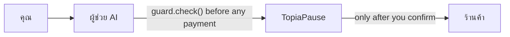

# u.bot integration (proposal)

**Works with u.bot and other AI assistants via the SDK.** This is a proposal, not a live u.bot connection. [u.bot](https://u.bot) has no public API, so the demo uses a mock adapter. The on-screen persona is **ผู้ช่วย AI (จำลอง)** / **AI assistant (demo)**. The mock uses the same client a real integration would use: `@topiapause/guard-client`.

## Where TopiaPause sits

The assistant calls the guard **before** any payment. The merchant is only reached after the person confirms.



## What the assistant sends

`POST /api/guard/check` with the person's words and the proposal that is about to be paid. The assistant does not send `policy` or `intent`. The person's app already minted `policyToken`. Full field list: [API.md](API.md).

```json
{
  "userMessage": "Sign me up for PixelPro, just to try it.",
  "lang": "en",
  "policyToken": "<from POST /api/policy>",
  "proposal": {
    "kind": "subscription",
    "proposalId": "sub-1",
    "agent": { "name": "u.bot", "adapter": "real" },
    "summary": "PixelPro Annual",
    "merchant": "PixelPro",
    "planId": "pixelpro-annual",
    "planName": "PixelPro Annual",
    "price": { "minor": 399000, "currency": "THB" },
    "interval": "year",
    "autoRenew": true,
    "trialDays": 0,
    "catalogAlternatives": [
      { "planId": "pixelpro-monthly", "name": "PixelPro Monthly", "price": { "minor": 29900, "currency": "THB" }, "interval": "month", "trialDays": 7 }
    ]
  }
}
```

Money is integer minor units. 399000 satang is ฿3,990.00. Crypto stays in micro-USDT, never baht.

## What the assistant gets back

`decision` is `allow`, `pause`, or `block`. On a pause, `counterOffer` is present only when that safer option itself passes every rule. `check.llmCalls` is 0.

```json
{
  "decision": "pause",
  "verdictId": "<ticket>",
  "counterOffer": { "recheck": "allow" },
  "explanation": { "source": "template" },
  "check": { "llmCalls": 0, "estCostTHB_satang": 1, "estimate": true }
}
```

Confirming is a second call, and only for that counter-offer. `choice: "original"` is `400 original_not_confirmable`. The paused payment cannot be confirmed through the API.

```json
{ "verdictId": "<ticket>", "choice": "counter_offer" }
```

```json
{ "confirmation": "<token bound to that ticket>" }
```

## Ten lines

```ts
import { createGuard } from '@topiapause/guard-client';

const guard = createGuard({ baseUrl: 'https://topiapause.example.workers.dev', policyToken });
const verdict = await guard.check({ userMessage, proposal, lang: 'th' });
if (verdict.decision === 'pause' && verdict.counterOffer) {
  // Show the plain-language reason. Wait for one explicit tap.
  const { confirmation } = await guard.confirm({ verdictId: verdict.verdictId, choice: 'counter_offer' });
  await executeCounterOffer(verdict.counterOffer.proposal, verdict.verdictId, confirmation);
}
```

`packages/guard-client` has no runtime dependencies. In this repo the web app's mock calls `ubotGuard()` in `apps/web/src/lib/ubot.ts`, which is that client pointed at the same origin.

## What u.bot gets out of it

The person sees a pause in plain words, and can hear it, before money moves. u.bot and other assistants can check with the person first: fewer surprises about a yearly plan, and a withdrawal permission that matches what they asked. The check itself is rules, so the cost stays on the meter at about **฿0.01** with **0 AI calls** ([COSTS.md](COSTS.md)).

## What TopiaPause never does

- It does not move money, hold a card, or talk to a bank.
- It does not execute the paused original, even if a caller asks to confirm it.
- It does not let the agent rewrite the user's rules or invent the intent.
- It does not store the microphone audio or the transcript from a spoken reply.
